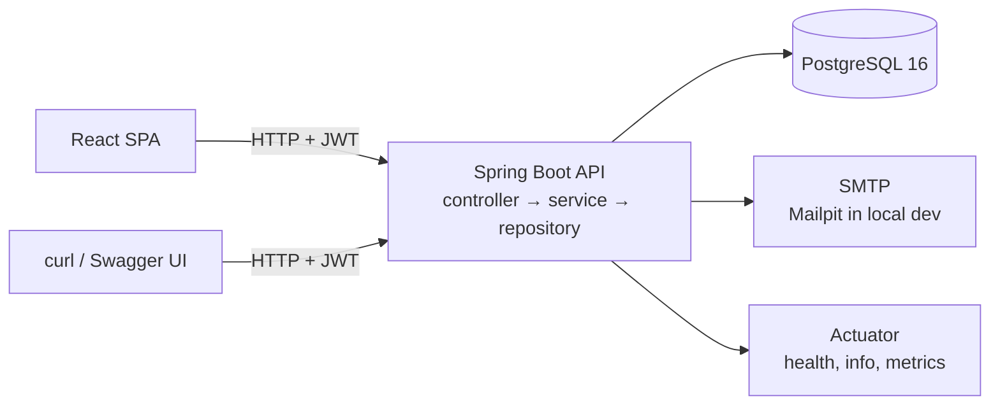

<div align="center">

# Ticket Tracker API

### A production-shaped REST API for project and ticket delivery

[](https://openjdk.org/projects/jdk/21/)
[](https://spring.io/projects/spring-boot)
[](https://www.postgresql.org/)
[](https://flywaydb.org/)
[](https://www.openapis.org/)
[](https://docs.docker.com/compose/)

**Built during the Nexttech internship program as a Java Backend Developer.**

</div>

---

## Table of contents

- [About the project](#about-the-project)
- [Features](#features)
- [Tech stack](#tech-stack)
- [Architecture](#architecture)
- [Getting started](#getting-started)
- [Configuration](#configuration)
- [API reference](#api-reference)
- [Authentication and authorization](#authentication-and-authorization)
- [Database](#database)
- [Scheduled jobs](#scheduled-jobs)
- [Error handling](#error-handling)
- [Observability](#observability)
- [Testing](#testing)
- [Project structure](#project-structure)
- [Known limitations and roadmap](#known-limitations-and-roadmap)
- [Acknowledgements](#acknowledgements)

---

## About the project

Ticket Tracker is a backend for a small delivery team: projects contain tickets, tickets have an assignee, a priority and a due date, and teammates discuss work in comments. The API is consumed by a React single-page application.

It was built during the **Nexttech internship program** as a **Java Backend Developer**, with the goal of going beyond a CRUD exercise: a contract-first API, stateless JWT authentication with refresh-token rotation, role-based access control, database migrations, scheduled email digests, structured logging and integration tests against a real PostgreSQL instance.

**Highlights**

- Contract-first API — the controller interfaces and DTOs are generated from `openapi.yaml`, so the specification cannot drift from the code.
- Stateless security — HMAC-signed JWT access tokens, BCrypt passwords, hashed and rotating refresh tokens, per-device session revocation.
- Three roles with different capabilities, enforced in two layers (path filter + method security).
- Daily digest emails rendered with Thymeleaf, deduplicated through `notification_log`.
- Flyway-managed schema with seeded demo data, validated by Hibernate on startup (`ddl-auto: validate`).
- Fully containerised local environment: API, PostgreSQL and Mailpit behind one `docker compose up`.

---

## Features

| Area | What is implemented |
| --- | --- |
| Authentication | Register, login, refresh, logout, logout from all devices |
| Tickets | Create, read, full update (`PUT`), partial update (`PATCH`), delete |
| Filtering | Status, priority, assignee, title search, due-date range, sorting, pagination |
| Projects | List, read, create, delete (blocked while tickets exist) |
| Comments | List, add, delete per ticket |
| Digest | Scheduled job at 08:00 plus an admin-only manual trigger |
| Validation | Bean Validation on every request body, consistent `400` responses |
| Docs | Swagger UI and OpenAPI JSON generated at runtime |
| Ops | Actuator health/info/metrics, trace IDs, rolling file logs |

---

## Tech stack

| Layer | Technology |
| --- | --- |
| Language | Java 21 |
| Framework | Spring Boot 4.1.1 (Web MVC, Validation, Security, Data JPA, Mail, Actuator, Thymeleaf) |
| Database | PostgreSQL 16, Flyway migrations, Hibernate in `validate` mode |
| Security | Spring Security resource server, Nimbus JWT (HS256), BCrypt |
| API contract | OpenAPI 3 + `openapi-generator-maven-plugin` (Spring interfaces) |
| Mapping | MapStruct 1.6, Lombok |
| Docs | springdoc-openapi (Swagger UI) |
| Testing | JUnit 5, MockMvc, Testcontainers (PostgreSQL), H2 |
| Build & runtime | Maven (wrapper included), Docker multi-stage build, Docker Compose |

---

## Architecture



The application follows a classic layered design:

- **Controllers** implement interfaces generated from `src/main/resources/openapi/openapi.yaml`.
- **Services** hold business rules, transactions and permission-aware logic.
- **Repositories** are Spring Data JPA interfaces; dynamic ticket filtering uses JPA Specifications.
- **Mappers** (MapStruct) translate entities to the generated DTOs.

Role checks are applied twice: a `RoleAuthorizationFilter` rejects requests whose path is not allowed for the caller's role, and `@PreAuthorize` guards the operations that need object-level checks.

---

## Getting started

### Prerequisites

- Docker and Docker Compose (recommended path), or
- Java 21 and a running PostgreSQL instance, plus an SMTP server for the digest.

### Option A — Docker Compose (recommended)

The stack starts PostgreSQL, Mailpit and the API.

```bash
# 1. Create the environment file (see the Configuration section)
cp .env.example .env

# 2. Build and start everything
docker compose up -d --build

# 3. Follow the logs
docker compose logs -f app
```

| Service | URL |
| --- | --- |
| API | http://localhost:8080 |
| Swagger UI | http://localhost:8080/swagger-ui.html |
| Health | http://localhost:8080/actuator/health |
| Mailpit inbox | http://localhost:8025 |
| PostgreSQL | `localhost:5433` (database `ticket_tracker`) |

### Option B — Run locally

```bash
# 1. Start only the infrastructure
docker compose up -d postgres mailpit

# 2. Run the application (the Maven wrapper is included)
./mvnw spring-boot:run
```

On Windows:

```powershell
.\mvnw.cmd spring-boot:run
```

The application reads `.env` from the project root and starts with the `dev` profile. Flyway applies all migrations and the demo data automatically on first boot.

### Demo accounts

The seed migrations (`V3` and `V5`) create demo users, projects, tickets and comments.

| Email | Role | Password |
| --- | --- | --- |
| `admin2@test.com` | `ADMIN` | `password123` |
| `pm2@test.com` | `PROJECT_MANAGER` | `password123` |
| `member2@test.com` | `MEMBER` | `password123` |

The original `V3` accounts (`admin@test.com`, `pm@test.com`, `member@test.com`) are also present with a pre-hashed password.

### Useful commands

```bash
./mvnw clean package          # build the executable jar into target/
./mvnw test                   # unit + integration tests
./mvnw spring-boot:run        # run from source
docker compose down -v        # stop and remove the database volume
```

---

## Configuration

Configuration is environment-driven. The API imports `.env` automatically, so the file below is enough for local development.

```properties
# Database
DB_URL=jdbc:postgresql://localhost:5433/ticket_tracker
DB_USERNAME=app
DB_PASSWORD=change-me

# JWT (use a long random secret, at least 32 bytes)
JWT_SECRET=change-me-to-a-long-random-secret
JWT_ACCESS_EXPIRATION_MS=900000        # 15 minutes
JWT_REFRESH_EXPIRATION_MS=604800000    # 7 days

# Mail
MAIL_HOST=localhost
MAIL_PORT=1025

# Digest job
DIGEST_CRON=0 0 8 * * *
DIGEST_FROM=noreply@ticket-tracker.local
```

| Variable | Purpose | Default |
| --- | --- | --- |
| `DB_URL` | JDBC connection string | — (required) |
| `DB_USERNAME` / `DB_PASSWORD` | Database credentials | — (required) |
| `JWT_SECRET` | HMAC key for signing access tokens | — (required) |
| `JWT_ACCESS_EXPIRATION_MS` | Access token lifetime | `900000` (15 min) |
| `JWT_REFRESH_EXPIRATION_MS` | Refresh token lifetime | `604800000` (7 days) |
| `MAIL_HOST` / `MAIL_PORT` | SMTP server used by the digest | — |
| `DIGEST_CRON` | Digest schedule (Spring cron) | `0 0 8 * * *` |
| `DIGEST_ENABLED` | Enable or disable the digest job | `true` |
| `DIGEST_FROM` | Sender address | `noreply@ticket-tracker.local` |
| `REFRESH_TOKEN_CLEANUP_CRON` | Expired-token cleanup schedule | `0 0 3 * * *` |
| `SPRING_PROFILES_ACTIVE` | Active profile (`local`, `dev`, `prod`) | `dev` |
| `SECURITY_DEV_MODE` | Bypass the path-based role filter | `false` in `prod` |

Profiles differ only in verbosity and safety switches:

| Profile | Logging | Role path filter |
| --- | --- | --- |
| `local` | DEBUG, SQL logged | active |
| `dev` | DEBUG, SQL logged | **bypassed** (`security.dev-mode: true`) |
| `prod` | INFO | active |

> The `dev` profile deliberately relaxes the path filter for local debugging. The Docker Compose stack overrides it back to `false`, and production must always run with `security.dev-mode: false`.

---

## API reference

Base URL: `http://localhost:8080`. The full contract lives in [`src/main/resources/openapi/openapi.yaml`](src/main/resources/openapi/openapi.yaml) and is browsable at `/swagger-ui.html`.

### Authentication — `/api/auth`

| Method | Endpoint | Description | Access |
| --- | --- | --- | --- |
| `POST` | `/register` | Create a `MEMBER` account | Public |
| `POST` | `/login` | Exchange credentials for a token pair | Public |
| `POST` | `/refresh` | Rotate a refresh token | Public |
| `POST` | `/logout` | Revoke one refresh token | Public |
| `POST` | `/logout-all` | Revoke every session of the caller | Authenticated |

### Tickets — `/api/v1/tickets`

| Method | Endpoint | Description | Access |
| --- | --- | --- | --- |
| `GET` | `/tickets` | Paginated, filtered list | All roles |
| `GET` | `/tickets/{ticketId}` | Single ticket | All roles |
| `POST` | `/tickets` | Create a ticket | All roles |
| `PUT` | `/tickets/{ticketId}` | Full replace | All roles |
| `PATCH` | `/tickets/{ticketId}` | Partial update | Assignee, PM, Admin |
| `DELETE` | `/tickets/{ticketId}` | Delete a ticket | PM, Admin |

Query parameters for `GET /tickets`: `status`, `priority`, `assigneeId`, `dueBefore`, `dueAfter`, `titleContains`, `page` (zero-based), `size` (max 100), `sortBy` (`createdAt`, `dueDate`, `priority`, `title`), `sortDirection` (`asc`, `desc`).

### Projects — `/api/v1/projects`

| Method | Endpoint | Description | Access |
| --- | --- | --- | --- |
| `GET` | `/projects` | Paginated list | PM, Admin |
| `GET` | `/projects/{projectId}` | Single project | PM, Admin |
| `POST` | `/projects` | Create a project | PM, Admin |
| `DELETE` | `/projects/{projectId}` | Delete an empty project | Admin |

### Comments — `/api/v1/tickets/{ticketId}/comments`

| Method | Endpoint | Description | Access |
| --- | --- | --- | --- |
| `GET` | `/tickets/{ticketId}/comments` | All comments of a ticket | All roles |
| `POST` | `/tickets/{ticketId}/comments` | Add a comment | All roles |
| `DELETE` | `/tickets/{ticketId}/comments/{commentId}` | Delete a comment | All roles |

### Administration

| Method | Endpoint | Description | Access |
| --- | --- | --- | --- |
| `POST` | `/api/v1/admin/digest/trigger` | Send the digest immediately | Admin |

### Operations

| Endpoint | Description |
| --- | --- |
| `GET /actuator/health` | Liveness and dependency details |
| `GET /actuator/info` | Build and application metadata |
| `GET /actuator/metrics` | Micrometer metrics |
| `GET /v3/api-docs` | OpenAPI document as JSON |

### Quick start with curl

```bash
# Login
TOKEN=$(curl -s -X POST http://localhost:8080/api/auth/login \
  -H "Content-Type: application/json" \
  -d '{"email":"pm2@test.com","password":"password123"}' \
  | jq -r '.accessToken')

# List urgent, open tickets
curl -s "http://localhost:8080/api/v1/tickets?status=OPEN&priority=URGENT&size=10" \
  -H "Authorization: Bearer $TOKEN"
```

---

## Authentication and authorization

The API is stateless: no HTTP session, no cookies. Every protected request carries `Authorization: Bearer <accessToken>`.

```text
POST /api/auth/login
  → 200 { accessToken, refreshToken, expiresIn }
  → access token: 15 min, claims: sub (user id), email, role, iat, exp
  → refresh token: 7 days, stored only as a SHA-256 hash

Protected request with an expired access token
  → 401
  → POST /api/auth/refresh with the refresh token
  → old refresh token is revoked, a new pair is issued
  → the original request is retried once
```

- Passwords are hashed with BCrypt; the raw password is never logged or stored.
- Refresh tokens rotate on every use, so a stolen token is only useful until the legitimate client refreshes.
- `logout` revokes a single refresh token; `logout-all` revokes every token of the user.
- The security filter chain rejects unauthorized paths with `401` or `403` before the request reaches a controller.
- A scheduled cleanup removes expired and revoked refresh tokens every night.

### Roles

| Capability | `MEMBER` | `PROJECT_MANAGER` | `ADMIN` |
| --- | :-: | :-: | :-: |
| Read and create tickets | ✅ | ✅ | ✅ |
| Change status of assigned tickets | ✅ | ✅ | ✅ |
| Update any ticket | — | ✅ | ✅ |
| Delete tickets | — | ✅ | ✅ |
| Read and create projects | — | ✅ | ✅ |
| Delete projects | — | — | ✅ |
| Read and write comments | ✅ | ✅ | ✅ |
| Trigger the digest | — | — | ✅ |

Role rules are configured in `application.yml` (`security.role-paths`) and enforced by `RoleAuthorizationFilter`. Object-level rules use `@PreAuthorize("@ticketSecurity.isAssigneeOrManagerOrAdmin(...)")`.

---

## Database

PostgreSQL is the source of truth. The schema is versioned with Flyway and validated by Hibernate at startup, so an entity that drifts from the migration fails the boot instead of corrupting data.

<div align="center">
  
</div>

### Migrations

| Version | File | Contents |
| --- | --- | --- |
| `V1` | `V1__create_tables.sql` | `users`, `projects`, `tickets`, `comments` and indexes |
| `V2` | `V2__add_refresh_tokens.sql` | `refresh_tokens` with unique hashes |
| `V3` | `V3__seed_demo_data.sql` | Base demo users, projects, tickets, comments |
| `V4` | `V4__add_notification_log.sql` | Digest history with a unique constraint per user, ticket and day |
| `V5` | `V5__seed_extra_demo_data.sql` | Extra users, projects, tickets, comments and digest history |

### Model in short

- `users` — identity plus `role` (`ADMIN`, `PROJECT_MANAGER`, `MEMBER`) and `auth_provider`.
- `projects` — created by a user; a project with tickets cannot be deleted.
- `tickets` — belongs to a project, optionally assigned to a user; `status` and `priority` are enums validated in the application.
- `comments` — belong to a ticket and an author; deleted with the ticket.
- `refresh_tokens` — one row per active session, storing only the token hash.
- `notification_log` — one row per email actually sent, preventing duplicate digests.

<details>
<summary>Application flow diagrams</summary>

**Authentication, session refresh and ticket flow**


**Navigation flow**


</details>

---

## Scheduled jobs

| Job | Default schedule | What it does |
| --- | --- | --- |
| `TicketDigestJob` | `0 0 8 * * *` | Emails each assignee their overdue and due-soon tickets |
| `RefreshTokenCleanupJob` | `0 0 3 * * *` | Deletes expired and revoked refresh tokens |

The digest:

1. selects tickets due before the end of tomorrow that are not `DONE` or `CANCELLED`;
2. groups them by assignee;
3. skips tickets already emailed to that user today (`notification_log`);
4. renders `templates/email/ticket-digest.html` with Thymeleaf and sends it over SMTP;
5. records every sent ticket under a shared `batch_id`.

In local development, Mailpit captures the messages at http://localhost:8025. The job can be triggered manually by an admin from the UI or with `POST /api/v1/admin/digest/trigger`.

---

## Error handling

All errors share one shape, produced by `GlobalExceptionHandler`:

```json
{
  "timestamp": "2026-02-14T09:21:33.512Z",
  "status": 400,
  "error": "Validation Failed",
  "message": "title: must not be blank, priority: must not be null",
  "path": "/api/v1/tickets"
}
```

| Status | When it is returned |
| --- | --- |
| `400` | Validation failure, malformed JSON, invalid date range, project with tickets |
| `401` | Invalid credentials, expired or revoked refresh token, missing authentication |
| `403` | Role is not allowed on the path, or not the assignee for `PATCH` |
| `404` | Ticket, project, comment or user not found |
| `409` | Email already registered, or a database constraint violation |
| `500` | Unexpected error — logged with stack trace, generic message to the client |

Validation errors are flattened into `field: message` pairs, so clients can show them without parsing nested structures.

---

## Observability

- **Trace IDs** — `TraceIdFilter` accepts an incoming `X-Trace-Id` or generates one, puts it in the MDC and echoes it back in the response header.
- **Request logging** — `LoggingAspect` logs the HTTP method, path, status and duration of every controller call, and masks request bodies on `/api/auth/login` and `/api/auth/register`.
- **Log files** — `logback-spring.xml` writes rolling files to `logs/` (100 MB per file, 30 days of history, 1 GB total cap).
- **Metrics** — Actuator exposes `health`, `info` and `metrics`; health details include database and mail status.

```bash
curl -s http://localhost:8080/actuator/health | jq
curl -s -H "X-Trace-Id: my-trace-1" http://localhost:8080/actuator/info
```

---

## Testing

```bash
./mvnw test                       # everything
./mvnw test -Dtest=TicketServiceTest
./mvnw test -Dtest='*IntegrationTest'
```

| Suite | Coverage |
| --- | --- |
| `unit/service` | Business rules for auth, tickets, projects and comments |
| `integration/controller` | HTTP contract with MockMvc: status codes, payloads, validation |
| `integration/flow` | End-to-end scenarios including role authorization |
| `integration/repository` | Flyway migrations and queries against PostgreSQL via Testcontainers |
| `specification` | Filter and sort combinations for ticket search |
| `unit/exception` | Mapping of every exception to the shared error contract |

The Testcontainers test starts a real PostgreSQL container, so it requires a running Docker daemon.

---

## Project structure

```text
ticket-tracker/
├── docs/                          # exported diagrams (entity, flow, sequence)
├── src/main/java/com/example/skeleton/
│   ├── aspect/                    # request logging aspect
│   ├── config/                    # security, OpenAPI, scheduling, trace filter
│   ├── controller/                # REST controllers (generated interfaces)
│   ├── domain/
│   │   ├── enums/                 # Role, TicketStatus, Priority, AuthProvider
│   │   └── model/                 # JPA entities
│   ├── exception/                 # domain exceptions + global handler
│   ├── job/                       # digest and token-cleanup jobs
│   ├── mapper/                    # MapStruct mappers
│   ├── repository/                # Spring Data repositories
│   ├── security/                  # JWT, refresh tokens, role filter
│   ├── service/                   # service contracts and implementations
│   ├── specification/             # ticket filtering with JPA Criteria
│   └── utils/                     # request validation helpers
├── src/main/resources/
│   ├── db/migration/              # Flyway migrations and seed data
│   ├── openapi/                   # openapi.yaml + schemas.yaml
│   └── templates/email/           # Thymeleaf digest template
├── src/test/                      # unit, integration and Testcontainers tests
├── docker-compose.yml
├── Dockerfile
└── pom.xml
```

The OpenAPI generator writes interfaces and DTOs to `target/generated-sources/openapi`. To change the contract, edit `openapi.yaml` (and `schemas.yaml`), then rebuild — the compiler will point out every controller that no longer matches.

---

## Known limitations and roadmap

The project is feature-complete for its intended scope, and these gaps are deliberate or documented rather than hidden:

- **No user directory** — there is no endpoint to list users or fetch the current profile (`/me`). Clients resolve names from project creators and fall back to user IDs.
- **No project update** — projects can be created and deleted, but not renamed.
- **No project filter on tickets** — `GET /api/v1/tickets` cannot filter by `projectId`; clients filter client-side.
- **`PUT /tickets/{id}` is coarser than `PATCH`** — it is guarded by the role path filter only, while `PATCH` additionally checks that the caller is the assignee, a PM or an admin.
- **Comment deletion is not author-scoped on the server** — any authenticated user allowed on the ticket path can delete a comment; the UI applies the stricter policy.
- **No CORS configuration** — the frontend relies on a development proxy to avoid cross-origin calls.
- **Google sign-in is not implemented** — the OAuth2 client dependency is present, but only `LOCAL` accounts are supported.

Planned next steps: a user directory endpoint, a project update endpoint, an author check on comment deletion, CORS configuration for deployed clients, request rate limiting on auth endpoints, and a CI pipeline running the Testcontainers suite.

---

## Acknowledgements

Built during the **Nexttech internship program** as a **Java Backend Developer**. Thanks to the Nexttech engineering team for the mentorship, code reviews and the space to design the API end to end.

This repository is an educational and portfolio project; no license file has been added yet.
